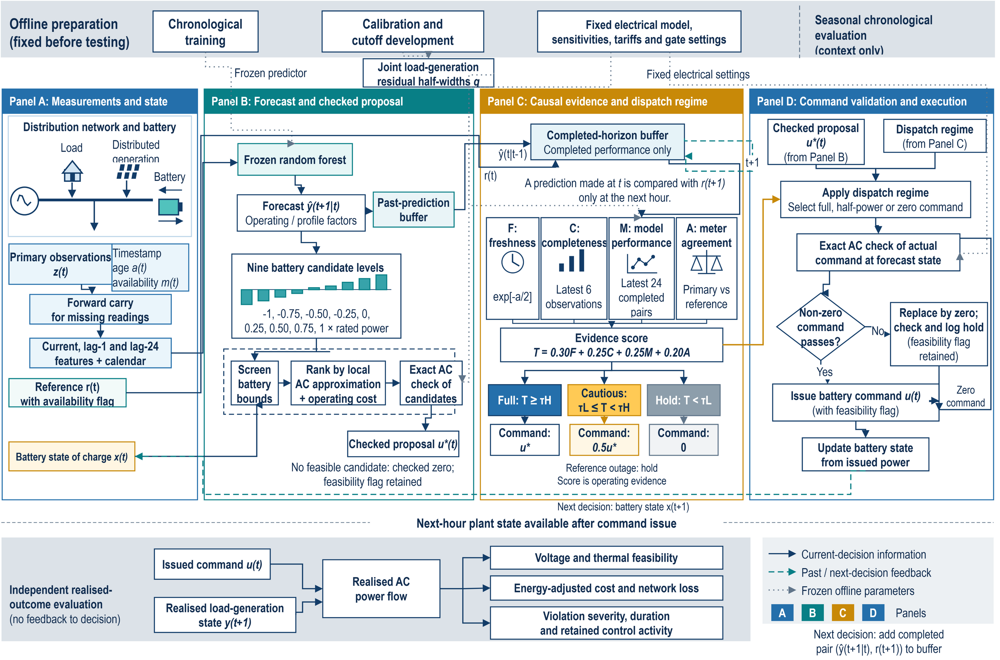
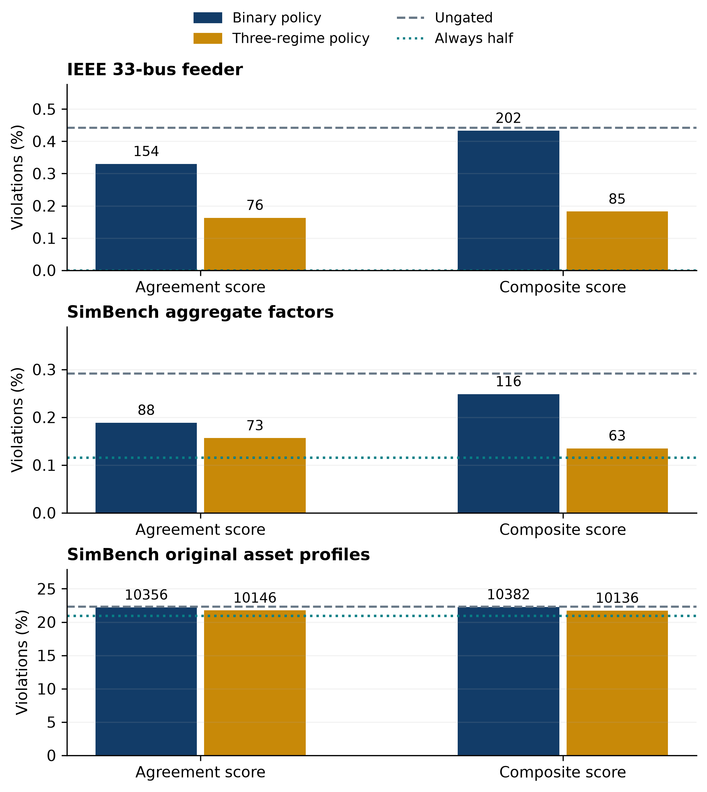

<div align="center">

# TUDT-F

### Causal trust gating for battery dispatch
**Distribution networks · Measurement quality · Storage capability**

[](https://github.com/Devchandrasen/tudt-f-smart-energy/actions/workflows/checks.yml)
[](https://www.python.org/downloads/)
[](https://github.com/Devchandrasen/tudt-f-smart-energy/releases/tag/v3.0.0)
[](LICENSE)
[](docs/data-provenance.md)

[Read the paper](manuscript/EPSR_Manuscript.pdf) · [Explore the results](docs/results.md) · [Reproduce](docs/reproduction.md) · [Download the archive](https://github.com/Devchandrasen/tudt-f-smart-energy/releases/tag/v3.0.0)

</div>

A reproducible simulation study of battery dispatch when primary or reference
measurements are missing, delayed, noisy or biased. The digital twin forecasts
operating factors, checks candidate power against AC constraints, and combines
current metadata with completed forecast evidence to select full power, half power
or a hold. An independent realised-state evaluator records physical and economic
outcomes after each command.

**Maintainer:** Chandrasen Pandey. The manuscript is prepared for *Electric Power
Systems Research*. It has not been accepted or submitted by this project workflow.



## Study at a glance

| Component | Executed v3.0.0 design |
| :--- | :--- |
| Electrical networks | IEEE 33-bus and 97-bus SimBench rural MV |
| Operating representations | IEEE aggregate, SimBench aggregate, original SimBench asset profiles |
| Forecast inputs | Two aggregate factors or 32 original profile-group factors |
| Comparators | Fourteen controls, including score-policy factorial and four channel removals |
| Conditions | Nine, including reference outage, reference noise and common bias |
| Chronology | Two rolling forecast origins; 24 non-overlapping 72-hour blocks |
| Replication | Three paired measurement seeds; 1,959,552 controller records |
| Validation | Full arithmetic audit, 228 fresh AC checks, 29 tests and action-feasibility diagnosis |

## What the experiments show

| Representation | Ungated violations | Composite, three regimes | Always half | Composite cost change vs ungated |
| :--- | ---: | ---: | ---: | ---: |
| IEEE 33 | 0.442% | 0.182% | 0.000% observed | +EUR 26.22 |
| SimBench aggregate | 0.291% | 0.135% | 0.116% | +EUR 138.83 |
| SimBench original asset profiles | 22.306% | 21.725% | 20.960% | +EUR 25.08 |

Rates include every issued command, including holds. Cost changes are mean
energy-adjusted values per 72-hour block under the fixed study tariffs. The
always-half comparator has lower observed violations and lower cost than the
composite gate in all three cases. Composite evidence improves common-proposal
ranking over agreement at 50% and 75% coverage in the asset case, with no uniform
advantage across representations or coverage levels.

Every realised state has a feasible tested power before energy screening. Battery
energy limits exclude every feasible tested power during **65.21% of composite
failures with asset profiles**. This separates information and action choice from
the energy headroom required for sustained voltage support.



## Get started

Use Python 3.12 and an isolated environment:

```bash
git clone https://github.com/Devchandrasen/tudt-f-smart-energy.git
cd tudt-f-smart-energy
python -m venv .venv
```

Activate `.venv\Scripts\Activate.ps1` in PowerShell or
`source .venv/bin/activate` on Linux/macOS, then run:

```bash
python -m pip install -e .
python -m tudtf verify-extended
python -m unittest discover -s tests -v
```

To exercise the complete controller pipeline on a smaller asset-profile run:

```bash
python -m tudtf extended --quick --network "SimBench assets" --output results/ci-extended
python -m tudtf analyse-extended --results results/ci-extended
```

This check produces 672 controller records from one summer block and two conditions.
It is an execution check. The published study uses the full design above.
The [reproduction guide](docs/reproduction.md) covers the complete run, numerical
archive download, independent diagnostic and figure generation.

## Project map

```text
src/tudtf/                 Prediction, dispatch, evidence, analysis and verification
tests/                     Timing, profiles, action rules and archive integrity
results/epsr-summary/       v3.0.0 summaries, input factors, audits and SHA-256 digests
results/reference/          Historical v2.0.0 study retained for verification
manuscript/EPSR_*           Paper, numerical supplement and editable source
manuscript/epsr_figures/    Native PDF figures, draw.io architecture and trace data
docs/                      Methods, results, reproduction and provenance
.github/workflows/         Windows/Linux tests and small pipeline runs
```

The complete per-hour CSV is a versioned release asset. Generated full runs are
ignored by Git. [v2.0.0](https://github.com/Devchandrasen/tudt-f-smart-energy/releases/tag/v2.0.0)
and the [earlier OPSD implementation](https://github.com/Devchandrasen/tudt-f-smart-energy/tree/94a9e83)
use different experimental designs. Their values should be interpreted within
their own archive, rather than mixed with the EPSR study.

## Scope of the evidence

The models use balanced hourly AC operation, fixed topology and one active-power
battery. Voltage limits 0.95–1.05 p.u. are imposed study settings and differ from
the original SimBench bus bands. The IEEE line-current rating, storage placement
and tariffs are also study assumptions. All observed failures are voltage events;
the executed periods do not establish behaviour under binding thermal constraints.
The finite action grid, residual coverage and stress screening do not establish a
global OPF optimum or a safety guarantee. Uncertainty resamples complete physical
blocks, retaining their dependent measurements and controller records.

## Citation and reuse

Use [CITATION.cff](CITATION.cff) or GitHub's **Cite this repository** action. A paper
DOI has not been assigned. Cite SimBench, pandapower and the Baran–Wu feeder source
when reusing the benchmark. Original code and documentation use [MIT](LICENSE);
benchmark-derived tables retain [SimBench database terms](docs/data-provenance.md).
Manuscript and artwork rights are recorded in [NOTICE](NOTICE).

Reproducibility reports are welcome through [issues](https://github.com/Devchandrasen/tudt-f-smart-energy/issues).
See [CONTRIBUTING.md](CONTRIBUTING.md) before changing source or archived results.
