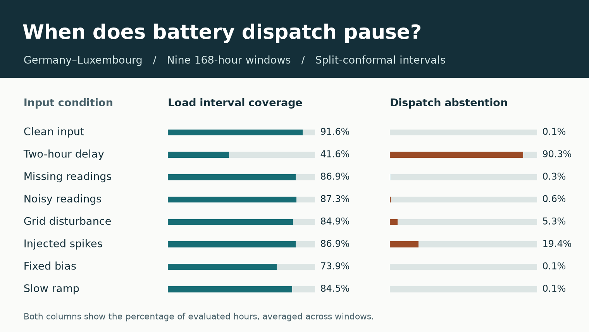

# TUDT-F | Trust-gated energy dispatch

How should a controller operate a battery when its latest meter reading is two hours old? TUDT-F uses measurement quality, forecast uncertainty and recent operating history to decide whether to issue a proposed command at full power, reduce it or defer it. The experiments track what happens to forecast-error exposure, grid violations and cost after that decision. A second task applies the same gate to solar curtailment.

[Run the replay](#run-the-replay) · [Browse experiments](#browse-experiments) · [Reproduce the study](docs/reproduction.md) · [Download the numerical archive](https://github.com/Devchandrasen/tudt-f-smart-energy/releases/tag/isj-revision-2026-11-18)



Coverage is the share of hours when measured next-hour load fell inside its forecast interval. Abstention counts decisions that deferred dispatch, including feasibility rejections. A scheduled zero-power command alone does not count as an abstention. The chart uses the frozen battery controller with split-conformal intervals and gives each of the nine German–Luxembourg windows equal weight. [Source values for all eight conditions](evidence/results/interval_summary.csv) · [Chart code](docs/plot_dispatch_conditions.py)

## Run the replay

Use Python 3.12. This example reads the checked-in counts from 18 fixed recordings. It runs from the checkout without downloading the numerical archive.

```sh
git clone --branch isj-revision-2026-11 --single-branch https://github.com/Devchandrasen/tudt-f-smart-energy.git
cd tudt-f-smart-energy
python -m pip install numpy==2.3.5 pandas==2.3.3
python evidence/offline_replay/summarize.py rerun/replay
```

Open `rerun/replay/weekly.csv` and compare `gate_high` with `ungated_high`. In the four weekly feedback cases, the two controllers issued nonzero commands during the same number of high-error, corrupted hours in each case. These are replays of fixed inputs. [Reference counts](evidence/offline_replay/reference/weekly.csv) · [Reproduction and verification](docs/reproduction.md)

## Browse experiments

| Experiment | Implementation | Data or results |
| --- | --- | --- |
| Battery dispatch and feeder stress | [Run dispatch and physical comparisons](audit_experiments.py) | [Frozen protocol](protocol.json) · [Numerical archive](https://github.com/Devchandrasen/tudt-f-smart-energy/releases/tag/isj-revision-2026-11-18) |
| PV curtailment and fallback | [Curtailment](pv_study.py) · [Fallback comparison](pv_followup.py) | [Fallback design](pv_followup_amendment.json) · [Numerical archive](https://github.com/Devchandrasen/tudt-f-smart-energy/releases/tag/isj-revision-2026-11-18) |
| Forecast intervals and stale readings | [Weighted intervals and stale-state alarms](evidence/experiments.py) · [Adaptive calibration](evidence/adaptive_pool.py) | [Interval comparison](evidence/results/interval_summary.csv) · [Alarm counts](evidence/results/stale_summary.csv) · [Adaptive results](evidence/adaptive_results/adaptive_pool_summary.csv) |
| Fixed-recording replay | [Aggregate recordings](evidence/offline_replay/summarize.py) | [Window counts](evidence/offline_replay/window_counts.csv) · [Weekly results](evidence/offline_replay/reference/weekly.csv) |
| Forecast errors and recorded event timing | [Forecast diagnostics](evidence/forecast_diagnostics/forecast_errors.py) · [Timing check](evidence/measurement_timing/check_timing.py) | [Forecast errors in kW](evidence/forecast_diagnostics/forecast_errors.csv) · [Six external timing profiles](evidence/measurement_timing/temporal_check.json) |

## What the comparisons show

- **Battery dispatch.** The selected gate reduced exposure to large forecast errors at the cost of more reviews and higher operating cost. Comparing scores under identical action rules gave no consistent advantage to the four-channel score. [Comparison design](audit_amendment.json)
- **PV curtailment.** Reducing or deferring curtailment could worsen violations. When the fallback accepted only forecast-feasible corrections, all 435,456 hourly commands matched the ungated controller. [Fallback experiment](pv_followup.py)
- **Delayed measurements.** In the two-hour delay case, recency weighting raised hourly load coverage from 41.6% to 42.4%. Both interval methods deferred dispatch in 90.3% of hours. [Interval comparison](evidence/results/interval_summary.csv)

The nine monthly windows are the units for paired inference. Scenarios and corruption seeds stay together within each window. Feeder stress results include null and adverse outcomes. Detector transfer to recorded disturbances was weak, and the timing data establish event order only. These simulations evaluate operating trade-offs and do not establish field safety. [Evaluation protocol](protocol.json) · [Source records](provenance/source_ledger.json)

## Data and provenance

This branch contains the reconstructed IEEE Systems Journal experiments. The original submitted implementation was unavailable. The frozen protocol and dated amendments distinguish the reconstruction from exploratory follow-ups. The default branch contains the separate EPSR study. [Reproduction guide](docs/reproduction.md) · [EPSR implementation](https://github.com/Devchandrasen/tudt-f-smart-energy/tree/main)

The code uses the MIT license. Energy data, RTE recordings and third-party annotations retain their respective attribution and reuse terms. [Code license](LICENSE) · [OPSD metadata](provenance/OPSD_datapackage.json) · [RTE recording license](provenance/RTE_ODbL.txt) · [Annotation license](provenance/RTE_annotation_BSD.txt)
